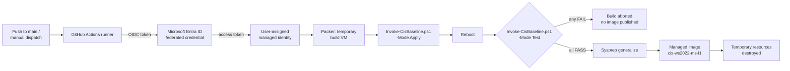

# Automated Windows Server CIS Golden Image Pipeline

[](https://github.com/Obscy02/Azure-Packer-CIS-Image/actions/workflows/packer.yml)

This project builds hardened Windows Server images in Azure. It checks each image against controls mapped to the official CIS benchmark and only publishes it if everything passes. The pipeline runs in GitHub Actions with HashiCorp Packer, and it logs into Azure with OIDC, so there are no passwords or client secrets in the repo.

I built and tested all of it on an Azure for Students account through my university. That account comes with restrictions on regions, VM sizes and quota, which made getting the first green build harder than I expected. It also taught me a lot, and I've written that up under [Lessons learned](#lessons-learned).

## Why I built this

Hardening servers by hand is slow, it's easy to miss a step, and afterwards it's hard to prove what was actually applied. A golden image solves most of that. You harden once, a script checks the result, and every server built from the image starts from the same baseline.

I wanted to build that the way a real team would run it. The whole build lives in code and runs on every push. A script decides whether the image is good enough to publish, so nobody has to eyeball registry keys. The pipeline also gets fresh, short-lived Azure credentials on every run instead of keeping a secret in GitHub.

## How it works



When I push to `main` (or start the workflow by hand), GitHub Actions trades its OIDC token for an Azure access token through a federated credential on a managed identity. Packer then creates a temporary resource group, Key Vault and Windows Server VM in `belgiumcentral`. It uploads the baseline engine and controls catalog to the VM over WinRM and runs it in Apply mode.

After that, the VM reboots. Some of the settings, such as LSA protection, the TLS changes and the removed features, only take effect after a restart, so I check them on the rebooted system rather than trusting the script's output. The engine runs again in Test mode, and if any control fails, the build stops there. If everything passes, Sysprep generalises the VM, Packer captures it as a managed image, and the temporary resources are deleted.

### A passing build


## What gets hardened

Every control is defined once, as data, in [`controls/catalog.json`](controls/catalog.json). A single PowerShell engine reads that catalog to both apply and test each control, so the hardening and the compliance check can never disagree. Most controls are plain data (a registry value, a Windows feature, a service, an audit setting or a log size), and the few that need custom logic point to a small script in `controls/scripts/`.

Each control records the CIS recommendation numbers it implements, per Windows version, taken from the official benchmark PDF (for Server 2022, **CIS Microsoft Windows Server 2022 Benchmark v5.1.0**). When I checked the catalog against the PDF, some of my original controls turned out not to be CIS recommendations at all. WDigest and "Block Microsoft accounts" were dropped in v5, and the TLS settings were never in it. I kept them, because they're still good hardening, but they're now labelled **hardening** instead of CIS. The build summary shows which is which, and `-CisOnly` leaves them out.

Across all profiles, the catalog covers these areas (see [Profiles](#profiles) for what's in each one):

| # | Area | What it does |
|---|------|--------------|
| 1 | Credential protection | LSA protection (`RunAsPPL`), WDigest cleartext caching off, anonymous SAM/share enumeration blocked, Microsoft accounts blocked, cached logons limited (L2) |
| 2 | Authentication | SMB signing required (server and client), NTLMv2 only (LAN Manager level 5) |
| 3 | Attack surface | `FS-SMB1` and `PowerShell-V2` features removed |
| 4 | Name resolution | LLMNR off; NetBIOS over TCP/IP off, re-applied at every boot by a SYSTEM scheduled task |
| 5 | Remote Desktop | NLA required, TLS security layer, high encryption, drive redirection off; COM, LPT and Plug and Play redirection off (L2) |
| 6 | PowerShell logging (L2) | Script block and module logging on, Operational log raised to 256 MB |
| 7 | Cryptography | SSL 2.0/3.0 and TLS 1.0/1.1 off, TLS 1.2 enforced, .NET strong crypto (x64 and x86) |
| 8 | User rights | Deny network logon for Guests and local accounts (opt-in with `-Include URA-01`, or `URA-02` on a DC, since in a domain this belongs in Group Policy) |
| 9 | Auditing and services | Advanced audit policy subcategories, command-line process auditing, 1 GB Security log, Print Spooler closed to remote clients (and off on DCs, or on member servers at L2), baseline version stamp |
| 10 | Domain controllers | LDAP signing and channel binding required, Server Operators can't schedule tasks, machine account password changes allowed |

I also built in a few safeguards against unattended runs going wrong. The engine checks the machine's role first: it refuses workstations, and it won't apply the member server profile to a domain controller or the other way round. Windows command-line tools like `auditpol` and `wevtutil` don't always report failures in a way PowerShell notices, so I wrapped them: a non-zero exit code now fails the build instead of being silently ignored. Every run writes a full transcript to `C:\Windows\Temp\cis-baseline-apply.log` (or `-test.log`). Finally, the image gets a baseline version and build date stamped in the registry, so you can tell later which baseline a server started from.

### The compliance check

In Test mode, the engine checks every selected control against the rebooted VM and prints `[PASS]` or `[FAIL]` for each one, with the actual and expected values when something is wrong. The results are saved as JSON and copied back off the VM before a separate gate step decides whether to continue. A single failure stops Packer before Sysprep, so a broken image never gets published, but you still get the report showing exactly what failed.

Every build run also publishes its evidence. The Actions run page shows a summary table of each control's result, CIS recommendation numbers and ATT&CK mappings, and a `compliance-evidence` artifact contains the results JSON and an ATT&CK Navigator layer.

The catalog itself is tested too. On every push to `dev`, a free GitHub Actions workflow validates it against a JSON schema, runs Pester unit tests on the engine, lints the PowerShell, and runs `packer validate`, all without logging into Azure.

### ATT&CK coverage

Each control lists the MITRE ATT&CK techniques it relates to, and whether it **mitigates** the technique or helps **detect** it. I kept that distinction deliberately. Turning off WDigest stops plaintext passwords being dumped from LSASS (T1003.001), so it mitigates. PowerShell script block logging doesn't stop malicious PowerShell (T1059.001), it records it, so it only detects. A few controls, like the Security log size, don't map honestly to a single technique, so they have no mapping rather than a stretched one.

From the selected controls, each build generates an ATT&CK Navigator layer: green for mitigated, blue for detected, and teal for both, with a comment listing which controls cover each technique. To view it, download the `compliance-evidence` artifact from a build run, open the [ATT&CK Navigator](https://mitre-attack.github.io/attack-navigator/), choose **Open Existing Layer → Upload from local**, and pick `attack-layer.json`.

The mappings are against ATT&CK Enterprise v16, and a test checks every technique ID against a reviewed list so a typo can't slip in.

### No stored credentials

The pipeline logs in with OIDC workload identity federation and a user-assigned managed identity. Each run, GitHub hands out a short-lived token, and Entra ID only accepts it if it comes from this repo and branch. The three GitHub secrets are just IDs (client, tenant and subscription), so nothing in the repo would be useful to an attacker or needs rotating.

## Profiles

CIS benchmarks treat member servers and domain controllers differently, and each has a Level 1 (essential) and Level 2 (defence in depth, may affect some applications) profile. Every control in the catalog records which roles and level it belongs to, and the engine selects controls with `-Role ms|dc` and `-Level 1|2`.

| Profile | Controls (CIS + hardening) | CIS recommendations covered | How the pipeline tests it |
|---|---|---|---|
| **Member server, Level 1** | 18 (10 + 8) | 28 | Every push to `main` builds and captures it |
| **Member server, Level 2** | 24 (14 + 10) | 34 | Manual run with level `2`; the image is captured |
| **Domain controller, Level 1** | 22 (14 + 8) | 31 | Manual run with role `dc` (see below) |
| **Domain controller, Level 2** | 26 (16 + 10) | 35 | Manual run with role `dc` and level `2` |

Counts are for Server 2022. One control can cover several CIS recommendations; for example, the audit policy control covers 11 of them.

**Domain controllers aren't golden images.** You can't Sysprep a DC, so in practice you build a member server image, deploy it, promote it, and then run the engine on the live DC:

```powershell
.\scripts\Invoke-CisBaseline.ps1 -Mode Apply -Role dc -Level 1
# reboot, then
.\scripts\Invoke-CisBaseline.ps1 -Mode Test -Role dc -Level 1
```

To prove the DC profile works, the pipeline has a throwaway DC build. With role `dc`, Packer promotes the build VM to the first domain controller of a lab forest (`lab.example.internal`), applies and tests the DC profile, and then deletes everything without capturing an image.

To run a profile, go to **Actions → Build CIS Windows Golden Image → Run workflow** and choose the Windows version, role and CIS level.

**How much of CIS this covers:** the Server 2022 benchmark has 299 Level 1 recommendations for member servers, and this catalog implements 28 of them, so about 9%. I focused on the settings with the most security value (credential theft, NTLM relay, RDP, logging and auditing) and on getting the engine, evidence and profiles right. Adding more controls is now mostly data entry.

**Windows versions.** Packer can build Server 2019, 2022 and 2025 (`-var os=ws2019|ws2022|ws2025`), and each version gets its own image, such as `cis-ws2025-ms-l1`. CIS numbers its recommendations differently in each benchmark, so the catalog stores the refs per version. A version is only offered once its benchmark has been mapped.

## Repository structure

```text
├── .github/
│   └── workflows/
│       ├── packer.yml            # Image build (OIDC login, Packer init/validate/build)
│       └── validate.yml          # Free checks on dev: tests, lint, packer validate
├── controls/
│   ├── catalog.json              # Every control, the single source of truth
│   ├── catalog.schema.json       # Schema the catalog is validated against
│   └── scripts/                  # Apply/test scripts for controls that need custom logic
├── engine/
│   └── CisBaseline.psm1          # Loads, filters, applies and tests controls
├── scripts/
│   └── Invoke-CisBaseline.ps1    # Entry point: -Mode Apply|Test -Os -Role -Level [-CisOnly]
├── tests/                        # Pester tests for the catalog and engine
├── windows-server.pkr.hcl        # Packer azure-arm template
└── README.md
```

## Lessons learned

Most of the time on this project went into getting it to run at all, not into writing the hardening script. These are the problems I ran into.

**The login kept failing even though everything looked right.** Every run failed with `AADSTS700213: No matching federated identity record found`. It turned out GitHub now puts the owner and repo IDs in the token subject (`repo:Obscy02@99282799/Azure-Packer-CIS-Image@1430078707:ref:refs/heads/main`), and that didn't match the `repo:owner/repo:...` format I'd set up in Azure. Copying the exact subject from the error fixed it. The ID-based format is also safer: if the repo is deleted and someone creates a new one with the same name, their tokens won't match.

**I couldn't create an app registration.** The usual setup uses an app registration in Entra ID, but as a student I don't have rights to create those in the university's directory. A user-assigned managed identity lives inside my own subscription and supports federated credentials, so it did the same job without needing an admin, and without a client secret.

**Finding a VM that Azure would actually give me.** The student subscription only allows five EU regions, and within those I hit three different problems. `SkuNotAvailable` meant the region had no capacity for that size, and `QuotaExceeded` meant I had a limit of 0 cores for that VM family. On top of that, the CLI and quota APIs returned nothing at all for my subscription, so I couldn't simply look up what I was allowed. In the end, the VM creation page in the Azure portal was what showed which sizes I could use, and that led me to `belgiumcentral` with the DSv2 family. Along the way, I made the VM size an input on the workflow so I could try different sizes without a new commit each time.

## Running it yourself

You'll need an Azure subscription where you can create resource groups, VMs and role assignments, a copy of this repo on GitHub, and either the Azure CLI or Cloud Shell.

### 1. Create the resource group and managed identity
```bash
az group create -n rg-devsecops-lab -l belgiumcentral
az identity create -n id-github-packer -g rg-devsecops-lab -l belgiumcentral
```
The finished image goes into `rg-devsecops-lab`, so the group needs to exist before the first build.

### 2. Give the identity access
Packer creates its own temporary resource group, so the identity needs Contributor on the subscription:
```bash
SUB=$(az account show --query id -o tsv)
PID=$(az identity show -n id-github-packer -g rg-devsecops-lab --query principalId -o tsv)
az role assignment create --assignee-object-id $PID --assignee-principal-type ServicePrincipal \
  --role Contributor --scope /subscriptions/$SUB
```

### 3. Add the federated credential
```bash
az identity federated-credential create \
  --name github-main \
  --identity-name id-github-packer \
  --resource-group rg-devsecops-lab \
  --issuer https://token.actions.githubusercontent.com \
  --subject "repo:<owner>/<repo>:ref:refs/heads/main" \
  --audiences api://AzureADTokenExchange
```
If the login step fails with `AADSTS700213`, copy the subject from the error message into this credential. See [Lessons learned](#lessons-learned) for why.

### 4. Add the GitHub secrets
Under **Settings → Secrets and variables → Actions**:

| Secret | How to get it |
|--------|---------------|
| `AZURE_CLIENT_ID` | `az identity show -n id-github-packer -g rg-devsecops-lab --query clientId -o tsv` |
| `AZURE_TENANT_ID` | `az account show --query tenantId -o tsv` |
| `AZURE_SUBSCRIPTION_ID` | `az account show --query id -o tsv` |

### 5. Run it
Push to `main`, or go to **Actions → Build CIS Windows Golden Image → Run workflow** and pick a Windows version, role, CIS level and VM size. The image shows up in `rg-devsecops-lab` named after the profile, for example `cis-ws2022-ms-l1`.

If your subscription isn't a student one, you'll probably want a different region and a bigger VM. Both are set in `windows-server.pkr.hcl`. Also, if a build fails part-way, check for leftover `pkr-Resource-Group-*` resource groups and delete them so they don't keep costing money.

## What I'd add next

There's plenty I'd like to do with this:

- Build a simple **web front end** where you pick the OS, role and level, see the CIS and ATT&CK coverage, and get the pipeline config for those choices.
- Cover **more of the CIS benchmark**, starting with password and lockout policy, user rights and the Windows Firewall.
- Add other frameworks, such as **DISA STIG**, alongside CIS in the same catalog.
- Let it **generate the infrastructure code** for the chosen baseline (Packer, Bicep or Terraform), so other teams can drop it into their own pipelines.
- Publish to an **Azure Compute Gallery** with version numbers instead of overwriting one image.
- Rebuild **monthly** so the image always has the latest Windows updates.
