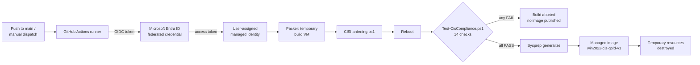
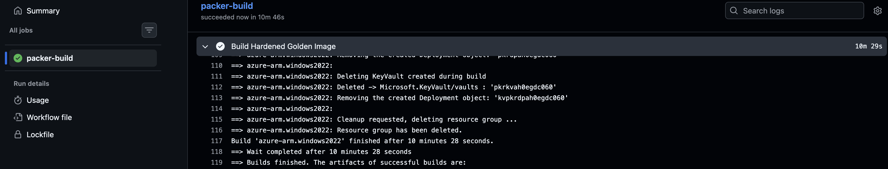

# Automated Windows Server 2022 CIS Golden Image Pipeline

[](https://github.com/Obscy02/Azure-Packer-CIS-Image/actions/workflows/packer.yml)

This project builds a hardened Windows Server 2022 image in Azure. It checks the image against a set of CIS Level 1 controls and only publishes it if everything passes. The pipeline runs in GitHub Actions with HashiCorp Packer, and it logs into Azure with OIDC, so there are no passwords or client secrets in the repo.

I built and tested all of it on an Azure for Students account through my university. That account comes with restrictions on regions, VM sizes and quota, which made getting the first green build harder than I expected. It also taught me a lot, and I've written that up under [Lessons learned](#lessons-learned).

## Why I built this

Hardening servers by hand is slow, it's easy to miss a step, and afterwards it's hard to prove what was actually applied. A golden image solves most of that. You harden once, a script checks the result, and every server built from the image starts from the same baseline.

I wanted to build that the way a real team would run it. The whole build lives in code and runs on every push. A script decides whether the image is good enough to publish, so nobody has to eyeball registry keys. The pipeline also gets fresh, short-lived Azure credentials on every run instead of keeping a secret in GitHub.

## How it works



When I push to `main` (or start the workflow by hand), GitHub Actions trades its OIDC token for an Azure access token through a federated credential on a managed identity. Packer then creates a temporary resource group, Key Vault and Windows Server 2022 VM in `belgiumcentral`, and runs `CIShardening.ps1` on it over WinRM.

After that, the VM reboots. Some of the settings, such as LSA protection, the TLS changes and the removed features, only take effect after a restart, so I check them on the rebooted system rather than trusting the script's output. `Test-CisCompliance.ps1` runs next, and if any check fails, the build stops there. If everything passes, Sysprep generalises the VM, Packer captures it as a managed image, and the temporary resources are deleted.

### A passing build



## What gets hardened

The hardening script is split into nine areas:

| # | Area | What it does |
|---|------|--------------|
| 1 | Credential protection | LSA protection (`RunAsPPL`), WDigest cleartext caching off, anonymous SAM/share enumeration blocked, Microsoft accounts blocked |
| 2 | Authentication | SMB signing required (server and client), NTLMv2 only (LAN Manager level 5) |
| 3 | Attack surface | `FS-SMB1` and `PowerShell-V2` features removed |
| 4 | Name resolution | LLMNR off; NetBIOS over TCP/IP off, re-applied at every boot by a SYSTEM scheduled task |
| 5 | Remote Desktop | NLA required, TLS security layer, high encryption, drive redirection off |
| 6 | PowerShell logging | Script block and module logging on, Operational log raised to 256 MB |
| 7 | Cryptography | SSL 2.0/3.0 and TLS 1.0/1.1 off, TLS 1.2 enforced, .NET strong crypto (x64 and x86) |
| 8 | User rights | Deny network logon for Guests and local accounts (opt-in with `-ApplyUserRights`, since in a domain this belongs in Group Policy) |
| 9 | Auditing and services | Advanced audit policy subcategories, command-line process auditing, 1 GB Security log, Print Spooler off, baseline version stamp |

I also built in a few safeguards against unattended runs going wrong. The script checks the machine's role first and refuses to run on a workstation or a domain controller. Windows command-line tools like `auditpol` and `wevtutil` don't always report failures in a way PowerShell notices, so I wrapped them: a non-zero exit code now fails the build instead of being silently ignored. Every run writes a full transcript to `C:\Windows\Temp\cis-hardening.log`. Finally, the image gets a baseline version and build date stamped in the registry, so you can tell later which baseline a server started from.

### The compliance check

`Test-CisCompliance.ps1` runs 14 checks against the rebooted VM and prints `[PASS]` or `[FAIL]` for each one. A single failure makes it exit with code 1, which stops Packer before Sysprep, so a broken image never gets published.

### No stored credentials

The pipeline logs in with OIDC workload identity federation and a user-assigned managed identity. Each run, GitHub hands out a short-lived token, and Entra ID only accepts it if it comes from this repo and branch. The three GitHub secrets are just IDs (client, tenant and subscription), so nothing in the repo would be useful to an attacker or needs rotating.

## Repository structure

```text
├── .github/
│   └── workflows/
│       └── packer.yml            # GitHub Actions pipeline (OIDC login, Packer init/validate/build)
├── scripts/
│   ├── CIShardening.ps1          # CIS Level 1 hardening baseline
│   └── Test-CisCompliance.ps1    # 14-point compliance check (exit 1 on any failure)
├── windows-server.pkr.hcl        # Packer azure-arm template
└── README.md
```

## Lessons learned

Most of the time on this project went into getting it to run at all, not into writing the hardening script. These are the problems I ran into.

**The login kept failing even though everything looked right.** Every run failed with `AADSTS700213: No matching federated identity record found`. It turned out GitHub now puts the owner and repo IDs in the token subject (`repo:Obscy02@99282799/Azure-Packer-CIS-Image@1430078707:ref:refs/heads/main`), and that didn't match the `repo:owner/repo:...` format I'd set up in Azure. Copying the exact subject from the error fixed it. The ID-based format is also safer: if the repo is deleted and someone creates a new one with the same name, their tokens won't match.

**I couldn't create an app registration.** The usual setup uses an app registration in Entra ID, but as a student I don't have rights to create those in the university's directory. A user-assigned managed identity lives inside my own subscription and supports federated credentials, so it did the same job without needing an admin, and without a client secret.

**Finding a VM that Azure would actually give me.** The student subscription only allows five EU regions, and within those I hit three different problems. `SkuNotAvailable` meant the region had no capacity for that size, and `QuotaExceeded` meant I had a limit of 0 cores for that VM family. On top of that, the CLI and quota APIs returned nothing at all for my subscription, so I couldn't simply look up what I was allowed. In the end, the VM creation page in the Azure portal was what showed which sizes I could use, and that led me to `belgiumcentral` with the DSv2 family. Along the way, I made the VM size an input on the workflow so I could try different sizes without a new commit each time.

## Running it yourself

You'll need an Azure subscription where you can create resource groups, VMs and role assignments, a copy of this repo on GitHub, and either the Azure CLI or Cloud Shell.

### 1. Create the resource group and managed identity
```bash
az group create -n rg-devsecops-lab -l belgiumcentral
az identity create -n id-github-packer -g rg-devsecops-lab -l belgiumcentral
```
The finished image goes into `rg-devsecops-lab`, so the group needs to exist before the first build.

### 2. Give the identity access
Packer creates its own temporary resource group, so the identity needs Contributor on the subscription:
```bash
SUB=$(az account show --query id -o tsv)
PID=$(az identity show -n id-github-packer -g rg-devsecops-lab --query principalId -o tsv)
az role assignment create --assignee-object-id $PID --assignee-principal-type ServicePrincipal \
  --role Contributor --scope /subscriptions/$SUB
```

### 3. Add the federated credential
```bash
az identity federated-credential create \
  --name github-main \
  --identity-name id-github-packer \
  --resource-group rg-devsecops-lab \
  --issuer https://token.actions.githubusercontent.com \
  --subject "repo:<owner>/<repo>:ref:refs/heads/main" \
  --audiences api://AzureADTokenExchange
```
If the login step fails with `AADSTS700213`, copy the subject from the error message into this credential. See [Lessons learned](#lessons-learned) for why.

### 4. Add the GitHub secrets
Under **Settings → Secrets and variables → Actions**:

| Secret | How to get it |
|--------|---------------|
| `AZURE_CLIENT_ID` | `az identity show -n id-github-packer -g rg-devsecops-lab --query clientId -o tsv` |
| `AZURE_TENANT_ID` | `az account show --query tenantId -o tsv` |
| `AZURE_SUBSCRIPTION_ID` | `az account show --query id -o tsv` |

### 5. Run it
Push to `main`, or go to **Actions → Build CIS Windows Golden Image → Run workflow** and pick a VM size. The image shows up as `win2022-cis-gold-v1` in `rg-devsecops-lab`.

If your subscription isn't a student one, you'll probably want a different region and a bigger VM. Both are set in `windows-server.pkr.hcl`. Also, if a build fails part-way, check for leftover `pkr-Resource-Group-*` resource groups and delete them so they don't keep costing money.

## What I'd add next

There's plenty I'd like to do with this:

- Map each control to the **MITRE ATT&CK** techniques it defends against, and produce a coverage report with each build. For example, turning off WDigest helps against LSASS credential dumping (T1003.001), disabling LLMNR and NetBIOS stops poisoning attacks (T1557.001), and SMB signing blocks relay attacks (T1557).
- Build a simple **web front end** where you pick the OS (Server 2019, 2022 or 2025), the benchmark (CIS or DISA STIG) and the level (L1 or L2), and it runs the pipeline with those choices.
- Let it **generate the infrastructure code** for the chosen baseline (Packer, Bicep or Terraform), so other teams can drop it into their own pipelines.
- Publish to an **Azure Compute Gallery** with version numbers instead of overwriting one image.
- Rebuild **monthly** so the image always has the latest Windows updates.
- Save the compliance results as a **build artifact** to use as audit evidence.
- Add the audit policy and Security log size to the compliance check. They're applied, but not checked yet.
